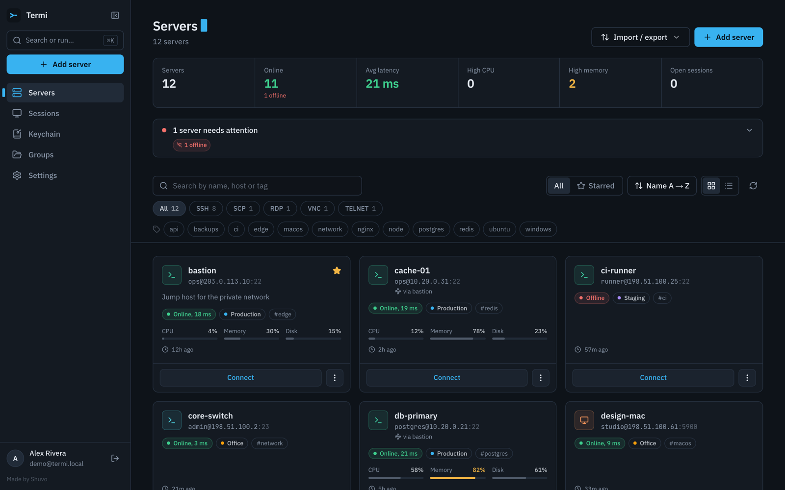
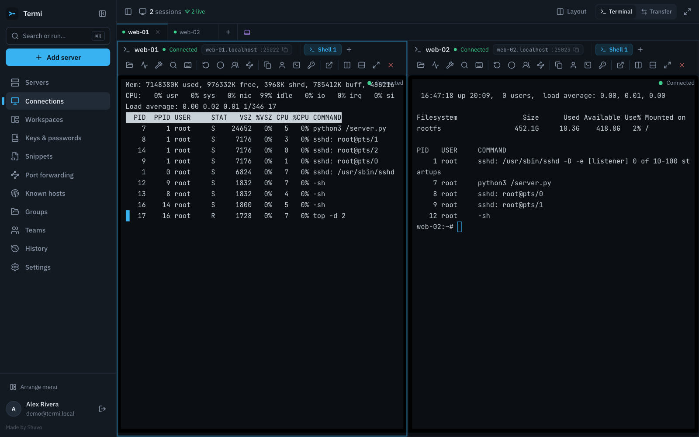
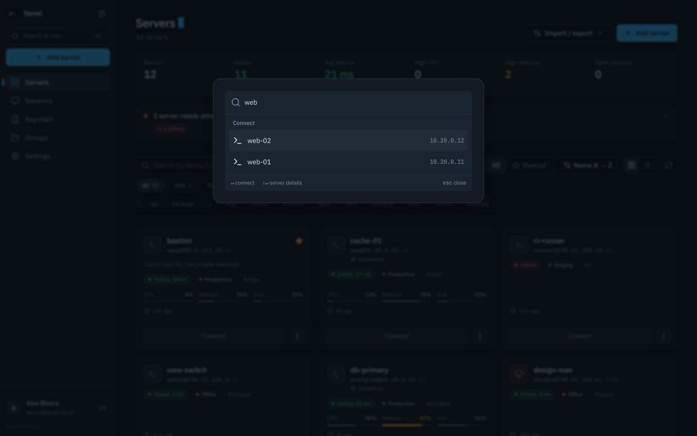
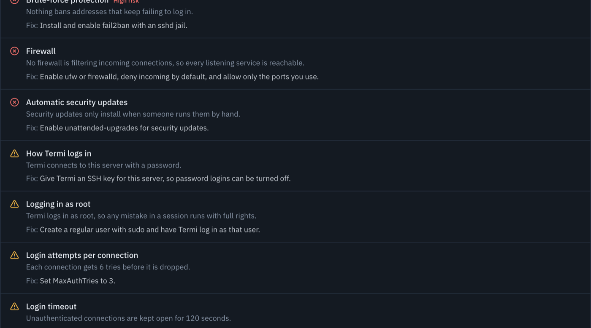
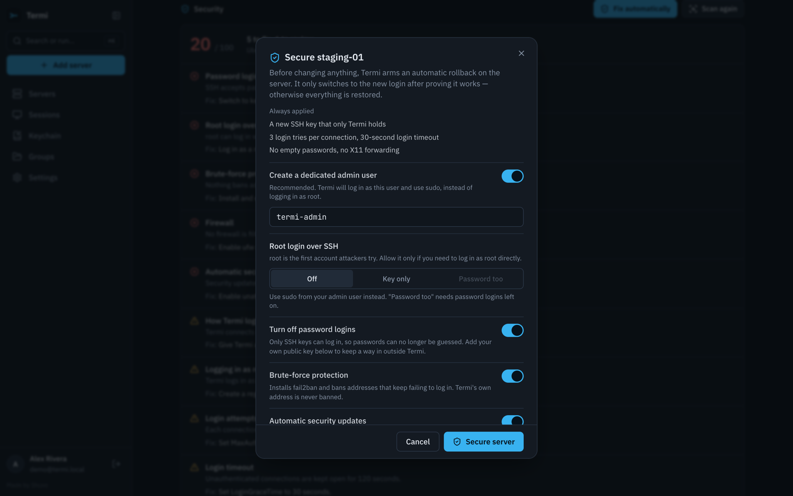
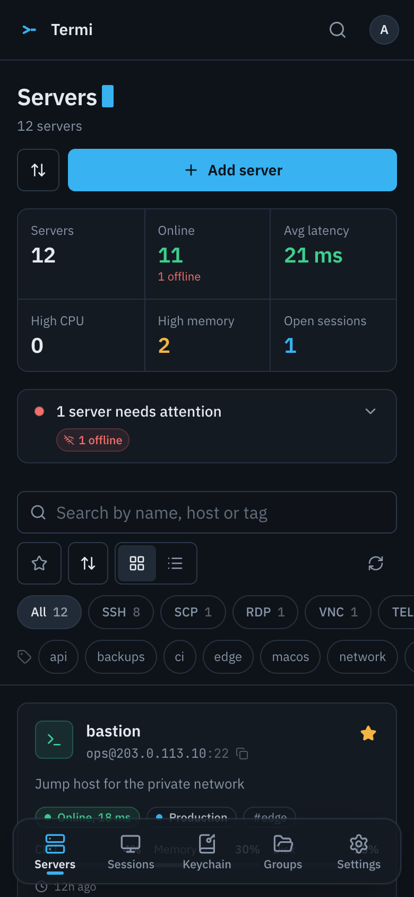
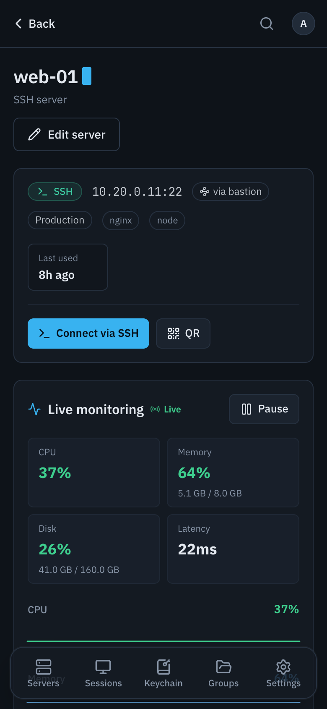

<div align="center">

# 🖥️ Termi

**Self-hosted server access — SSH, SFTP, RDP, VNC, Telnet and serial from your browser, phone or desktop, with an AI assistant that never sees your secrets**

_Termi runs in production at **[termi.run](https://termi.run)** — try it there, or follow [Quick Start](#-quick-start) to self-host your own instance._

[](https://github.com/shuv-o/termi/stargazers)
[](LICENSE)
[](https://github.com/shuv-o/termi/actions/workflows/ci.yml)
[](https://github.com/shuv-o/termi/actions/workflows/release.yml)
[](https://www.typescriptlang.org/)
[](https://nextjs.org/)
[](https://nodejs.org/)
[](https://www.docker.com/)

[](https://ko-fi.com/shuvoo)

**[🚀 Live Demo](https://termi.run)** · **[📖 Wiki](https://github.com/shuv-o/termi/wiki)** · **[⬇️ Download](https://github.com/shuv-o/termi/releases/latest)** · **[💬 Discussions](https://github.com/shuv-o/termi/discussions)**

</div>

> **⭐ If Termi is useful to you, please star the repo.** It costs nothing, takes two seconds, and is the main way other developers find this project — more effective than a clone, since a fork or a clone doesn't show up anywhere public. See [Why star instead of just cloning?](#-why-star-instead-of-just-cloning)

---

## 📸 Screenshots

<p align="center">
  
</p>

<table>
  <tr>
    <td width="50%"></td>
    <td width="50%"></td>
  </tr>
  <tr>
    <td align="center"><b>Split panes and workspaces</b> — several terminals side by side, reopened in one click</td>
    <td align="center"><b>Command palette</b> — <kbd>⌘K</kbd>, type a name, <kbd>Enter</kbd> to connect</td>
  </tr>
  <tr>
    <td width="50%"></td>
    <td width="50%"></td>
  </tr>
  <tr>
    <td align="center"><b>Security scan</b> — a score and plain-language findings for each server</td>
    <td align="center"><b>Fix automatically</b> — hardening with an on-server rollback if anything fails</td>
  </tr>
</table>

<p align="center">
  
  &nbsp;&nbsp;
  
</p>
<p align="center"><sub>Works on phones too: install it from the browser, or use the desktop app on macOS, Windows and Linux. Screenshots use demo data.</sub></p>

---

## 📑 Table of Contents

- [Features](#-features)
- [Quick Start](#-quick-start)
- [Desktop App Installation](#-desktop-app-installation)
- [Development Setup](#️-development-setup)
- [Configuration](#️-configuration)
- [Architecture](#-architecture)
- [Security](#-security)
- [Roadmap](#-roadmap)
- [Contributing](#-contributing)
- [Open Source & Community](#-open-source--community)
- [Why star instead of just cloning?](#-why-star-instead-of-just-cloning)
- [Star History](#-star-history)
- [License](#-license)

---

## ✨ Features

### 🔐 Security & Authentication

- **AES-256-GCM** encryption for all stored server credentials
- **scrypt** password hashing with secure parameters
- **TOTP-based 2FA** — works with Google Authenticator, Authy, and any TOTP app
- **Passkey / WebAuthn** — passwordless login with hardware keys and biometrics
- **Google OAuth** — "Sign in with Google" support
- **Single sign-on (OIDC)** — Okta, Entra ID, Google Workspace, Keycloak or any OpenID Connect provider, optionally required for chosen email domains
- **FIDO2 security keys** — YubiKey and other FIDO2 keys as SSH keys: the private key stays on the device, each login is a touch
- Zero-trust architecture — credentials are decrypted only in memory, never stored in plaintext
- **App lock** — lock after inactivity or on demand, enforced by the server; unlock with a password or passkey
- **SSH certificates & agent forwarding** — log in with OpenSSH user certificates; forward your keys to a server (optionally approving each use) without the keys ever leaving Termi
- **SSH host key verification** — each server's key is pinned on first connection (like `known_hosts`); a changed key is refused everywhere, reported, and can be reviewed and re-trusted from the server's page
- **One-click server hardening** — scan a server's SSH and firewall setup, get a security score, and fix it automatically: key-only login, a dedicated admin user, root-login choice, fail2ban, unattended updates, firewall and SSH port move. Every change is armed with an on-server rollback and verified on a fresh login before Termi stores the new credentials

### 🖥️ Multi-Protocol Remote Access

- **SSH** — full terminal emulation with [xterm.js](https://xtermjs.org/), key forwarding, and resizable viewport
- **SCP / SFTP** — web-based file manager: upload, download, create folders, rename, delete
- **RDP** — Windows Remote Desktop via [Apache Guacamole](https://guacamole.apache.org/), with touch-to-mouse translation and an on-screen keyboard on mobile
- **VNC** — Virtual Network Computing via Apache Guacamole, same mobile touch support
- **Telnet** — direct terminal access for legacy/unencrypted devices
- **Serial console** — USB console cables for network gear and boards, straight from Chrome, Edge or the desktop app (Web Serial)
- **Jump hosts** — reach servers behind a bastion, like `ssh -J`, for SSH, SFTP, tunnels, and RDP/VNC
- **Port forwarding** — local (`ssh -L`), SOCKS proxy (`ssh -D`) and remote (`ssh -R`), with no terminal needed. Local HTTP targets get a one-click browser link; everything runs in the desktop app or via a small Node.js bridge script, over one multiplexed connection per tunnel

### ⚡ Productivity

- **Global command palette** (⌘K / Ctrl+K) — jump to any server, group, keychain entry, or settings section without leaving the keyboard; press Enter on a server to connect straight away
- **Split panes & workspaces** — up to four sessions side by side, stacked or in a grid, optional typing into all panes at once, and named workspaces that reopen a whole setup in one click
- **Terminal search** — find text in the scrollback of SSH, Telnet, and local terminals (⌘F / Ctrl+Shift+F)
- **Command snippets** — save commands with `{{variables}}` (asked for each time, safely quoted with `|q`), type or run them in the active terminal, or run them on several servers at once with per-server output
- **Command suggestions** — fish-style completions from your per-server history and snippets, kept in your browser; passwords and space-prefixed commands are never remembered
- **Multi-server broadcast** — run a command across every server in a group at once, with a per-server results view
- **QR quick-connect** — scan a QR code from a mobile device to open a one-tap connection
- **Import from other clients** — bring your hosts over from `~/.ssh/config`, PuTTY / KiTTY, MobaXterm or a CSV (other clients and spreadsheets), with jump hosts and folders preserved and a preview before anything is saved
- **Session recording & playback** — record any SSH session and replay it later from History → Recordings, encrypted at rest
- **Connection history** — every terminal, file browser and desktop you opened, with time, device and IP, visible only to you
- **Your layout, your look** — Night, Black, Day or system themes, accent colours, compact density; the menu as a sidebar, icon rail or top bar on either side, in your own order, with your own phone bar; terminal colour schemes and fonts, synced to your account

### ✨ AI Assistant

- **Ask about your servers, errors and commands** in the Assistant page, or with **Ask AI** beside any terminal: explain what's on screen, find out why a command failed, or turn a request into a command. Suggested commands are pasted into the terminal, never run
- **Anthropic, OpenAI, or your own model**: the deployment can offer one to everyone (`AI_PROVIDER`, `AI_API_KEY`, `AI_MODEL`, `AI_BASE_URL`), and each user can bring their own key, model and endpoint, including OpenAI-compatible servers such as vLLM, Ollama or LM Studio
- **Secrets never leave**: every password, private key and passphrase Termi holds for you, plus anything that looks like a secret (keys in URLs, `password=…`, tokens), is removed before a message is sent or saved. The assistant knows your servers by name only, never their addresses or credentials
- **Memory**: conversations are kept (encrypted), and the assistant remembers lasting facts about your setup; you can see, delete or turn off what it remembers

### 💻 Local Terminal

- Access your **local machine's shell** directly from the app
- **Electron**: spawns PowerShell (Windows) or your default shell (macOS/Linux)
- **Browser/cloud**: spawns a shell on the gateway host (gated by `ALLOW_LOCAL_TERMINAL=true`)

### 📊 Server Monitoring

- Real-time **CPU, memory, and disk** metrics fetched over SSH, with a live metrics panel beside the terminal
- **Health history** charts
- Configurable **email, web push, and webhook** alerts (Slack, Discord, or any generic URL)
- Built-in **benchmark tool** with persisted history and a trend chart over time

### 🤝 Server Sharing

- **Teams** — a shared vault of servers with owner / admin / member roles and email invitations; members connect, owners keep the credentials
- **Shared live sessions** — invite someone to watch or work in your terminal; you approve each person and can remove them any time
- **Server sharing** — share one server with another user by email invitation, and revoke it any time
- Removing access (a share, a team member, a signed-in device) also closes the connections it allowed

### 📱 PWA & Mobile

- **Install as a PWA** on any device (iOS, Android, desktop)
- Virtual keyboard with Ctrl, Alt, Shift, Fn, and arrow keys
- Touch-optimised design
- **Web push notifications** for monitoring alerts

### 🖥️ Desktop App (Electron)

- Native app for **macOS, Windows, and Linux**
- Local terminal access via node-pty
- Connects to your self-hosted Termi instance
- **Connect from this computer**: SSH, files and port forwards to your own servers run through a gateway built into the app, so they reach whatever your computer can reach (per server: Termi server, This computer, or Automatic with fallback). Set up per sign-in in Settings → Devices, with a password or passkey
- Bundled gateway for fully offline / local-stack operation (`electron:dev:full`)

### 📦 Self-Hosted & Privacy-First

- **Docker Compose** one-command deployment
- **PostgreSQL** database — your data stays on your server
- **No telemetry**, no cloud dependencies
- [Traefik](https://traefik.io/) reverse-proxy support included

---

## 🚀 Quick Start

### Prerequisites

- [Docker](https://docs.docker.com/get-docker/) and [Docker Compose](https://docs.docker.com/compose/install/)

### Deploy with Docker

```bash
# 1. Clone the repository
git clone https://github.com/shuv-o/termi.git
cd termi

# 2. Copy and configure environment
cp .env.example .env
```

Open `.env` and set the required secrets (generate each with `openssl rand -base64 32`):

```dotenv
DB_HOST=postgres          # set to your DB host (Docker service name or external host)
DB_USER=termi
DB_PASSWORD=<strong-password>
DB_NAME=termi

SESSION_SECRET=<openssl rand -base64 32>
ENCRYPTION_KEY=<openssl rand -base64 32>
GATEWAY_JWT_SECRET=<openssl rand -base64 32>

NEXT_PUBLIC_GATEWAY_URL=ws://localhost:22080/gateway
NEXT_PUBLIC_APP_URL=http://localhost:22080
```

```bash
# 3. Start the stack (migrations and guacd for RDP/VNC are included)
docker compose up -d

# 4. Open Termi
open http://localhost:22080
```

### Deploy with Prebuilt Images

Skip building from source by pulling the published images instead. Every
tagged release (`v*.*.*`) publishes multi-arch (amd64 + arm64) images to both
[Docker Hub](https://hub.docker.com/u/shuvoo) and
[GitHub Container Registry](https://github.com/shuv-o/termi/pkgs/container/termi-web):

| Image              | Docker Hub             | GHCR                           |
| ------------------ | ---------------------- | ------------------------------ |
| Web (`@termi/web`) | `shuvoo/termi-web`     | `ghcr.io/shuv-o/termi-web`     |
| Gateway            | `shuvoo/termi-gateway` | `ghcr.io/shuv-o/termi-gateway` |

Both are tagged `latest` and with the release version (e.g. `1.0.10`).

```bash
git clone https://github.com/shuv-o/termi.git
cd termi
cp .env.example .env
# edit .env — same required secrets as the "Deploy with Docker" section above

docker compose -f docker-compose.prebuilt.yml up -d
```

To pull from GHCR instead of Docker Hub, or pin to a specific version, set in `.env`:

```dotenv
TERMI_WEB_IMAGE=ghcr.io/shuv-o/termi-web:1.0.10
TERMI_GATEWAY_IMAGE=ghcr.io/shuv-o/termi-gateway:1.0.10
```

The web image runs `prisma migrate deploy` automatically on first start —
no separate migration step needed.

> **Note:** the published images don't bake in `NEXT_PUBLIC_APP_URL` /
> `NEXT_PUBLIC_GATEWAY_URL` at build time (they're deployment-agnostic).
> If your setup needs those values compiled in rather than resolved at
> request time, build from source with `docker-compose.yml` instead.

---

## 💻 Desktop App Installation

Download the desktop app for your platform and architecture from the landing page.
Builds are provided for **macOS, Windows, and Linux** in both **x64** and **arm64**.

### macOS — first launch

The macOS build is **ad-hoc signed but not notarized** (the project has no paid
Apple Developer ID). On first launch, macOS Gatekeeper shows:

> _"Apple could not verify 'Termi.app' is free of malware…"_

This is expected. To open the app anyway, use either method:

**Option A — Right-click to open**

1. In Finder, locate **Termi.app** (drag it to `/Applications` first).
2. **Right-click** (or Control-click) the app → **Open**.
3. Click **Open** in the dialog. macOS remembers this choice for future launches.

**Option B — Remove the quarantine flag**

```bash
xattr -dr com.apple.quarantine /Applications/Termi.app
```

Then open the app normally.

### Windows

SmartScreen may warn that the publisher is unknown. Click **More info → Run anyway**.

### Linux

The Linux build is distributed as an **AppImage** — no installation required.

```bash
chmod +x termi.AppImage
./termi.AppImage
```

---

## 🛠️ Development Setup

### Prerequisites

- Node.js 22+
- PostgreSQL 15+ (or use Docker Compose)

```bash
# Install dependencies
npm install

# Copy and configure env
cp .env.example .env
# Edit .env — set DATABASE_URL (or DB_HOST/USER/PASS/NAME) + secrets

# Generate Prisma client
npm run db:generate

# Push schema to database
npm run db:push

# Start both services (web :22080, gateway :22081)
npm run dev:all
```

### Useful Commands

```bash
npm run dev:all          # Web + Gateway (recommended)
npm run dev              # Web only
npm run dev:gateway      # Gateway only

npm run db:migrate       # Create + apply a migration
npm run db:studio        # Prisma Studio database browser
npm run db:seed          # Seed with sample data

npm run check            # Lint + typecheck + unit tests
npm run test             # Unit tests (Vitest)
npm run test:e2e         # End-to-end tests (Playwright)
npm run test:security    # Security regression suite (needs Docker)
npm run lint             # ESLint across all workspaces
npm run build            # Production build

# Desktop app
npm run electron:dev              # Open Electron pointing at a running web instance
npm run electron:dev:full         # Run full local stack + Electron together
npm run build:electron            # Package Electron app
```

---

## ⚙️ Configuration

### Required Variables

| Variable                  | Description                                         |
| ------------------------- | --------------------------------------------------- |
| `DB_HOST`                 | PostgreSQL host                                     |
| `DB_USER`                 | PostgreSQL username                                 |
| `DB_PASSWORD`             | PostgreSQL password                                 |
| `DB_NAME`                 | Database name                                       |
| `SESSION_SECRET`          | iron-session cookie key (≥32 chars)                 |
| `ENCRYPTION_KEY`          | AES-256-GCM key for credentials at rest (≥32 chars) |
| `GATEWAY_JWT_SECRET`      | Shared secret for JWE connection tokens (≥32 chars) |
| `NEXT_PUBLIC_GATEWAY_URL` | Browser-visible WebSocket URL of the gateway        |
| `NEXT_PUBLIC_APP_URL`     | Public URL of the web app                           |

### Optional Variables

| Variable                           | Default               | Description                                                |
| ---------------------------------- | --------------------- | ---------------------------------------------------------- |
| `GUACD_HOST`                       | `localhost`           | guacd host for RDP/VNC                                     |
| `GUACD_PORT`                       | `4822`                | guacd port                                                 |
| `GUACD_TUNNEL_HOST`                | —                     | Gateway address guacd dials for RDP/VNC behind a jump host |
| `AI_PROVIDER`                      | —                     | AI assistant for everyone: `anthropic` or `openai` (OpenAI or any OpenAI-compatible server) |
| `AI_API_KEY`                       | —                     | The provider's API key (`ANTHROPIC_API_KEY` / `OPENAI_API_KEY` also work) |
| `AI_MODEL`                         | `claude-opus-5-5` for Anthropic | Any model name; required for OpenAI-compatible servers |
| `AI_BASE_URL`                      | —                     | Custom endpoint, e.g. `http://vllm:8000/v1` |
| `SEARCH_INDEXING`                  | `on`                  | `off` keeps this instance out of search results (robots.txt, meta tags, X-Robots-Tag); the signed-in app is never indexed |
| `GOOGLE_SITE_VERIFICATION` / `BING_SITE_VERIFICATION` | — | Ownership tokens for Google Search Console / Bing Webmaster Tools |
| `HSTS_PRELOAD`                     | `false`               | Send `includeSubDomains; preload` with HSTS (only for a domain you put on the preload list) |
| `TUNNEL_ORIGIN_TEMPLATE`           | —                     | Serve each port-forward tunnel from its own origin, e.g. `https://{id}.termi-tunnels.net` (wildcard DNS + cert, on a different domain than Termi) |
| `REDIS_URL`                        | —                     | Share rate limits across instances and restarts (falls back to memory) |
| `DB_SSLMODE`                       | —                     | TLS to Postgres, e.g. `verify-full`                        |
| `ENCRYPTION_KEY_FILE`              | —                     | Read `ENCRYPTION_KEY` from a file (Docker/Kubernetes secret) |
| `ENCRYPTION_KEY_PREVIOUS`          | —                     | Retired keys (comma-separated) still accepted while rotating; see `npm run db:reseal` |
| `ALLOW_PRIVATE_NETWORKS`           | `false`               | Allow connections to private/internal IPs                  |
| `TRUSTED_PROXY`                    | —                     | Proxy that sets the client IP: `cloudflare`, `x-real-ip` or `x-forwarded-for` |
| `ALLOWED_ORIGINS`                  | `NEXT_PUBLIC_APP_URL` | CORS origins for the gateway                               |
| `ALLOW_LOCAL_TERMINAL`             | `false`               | Enable local PTY terminal on the gateway host              |
| `GATEWAY_IDLE_TTL_HOURS`           | `8`                   | Close an SSH session after this long with no output or typing, tab open or closed |
| `GATEWAY_MAX_SESSION_DAYS`         | `7`                   | Close any SSH session after this many days, busy or not; `0` = no limit |
| `GATEWAY_ACCESS_CHECK_SEC`         | `30`                  | How often the gateway closes connections whose access ended (sign-out, password change, share or team removal); `0` = off |
| `WEB_INTERNAL_URL`                 | `NEXT_PUBLIC_APP_URL` | Where the gateway reaches the web app for that check (compose: `http://web:22080`) |
| `GATEWAY_MAX_CONNECTIONS_PER_USER` | `0`                   | Concurrent sessions per user; `0` = unlimited              |
| `GOOGLE_CLIENT_ID`                 | —                     | Google OAuth client ID                                     |
| `GOOGLE_CLIENT_SECRET`             | —                     | Google OAuth client secret                                 |
| `OIDC_ISSUER`                      | —                     | Single sign-on: your OpenID Connect provider's issuer URL (Okta, Entra ID, Google Workspace, Keycloak…). Redirect URI: `<app>/api/auth/sso/callback` |
| `OIDC_CLIENT_ID` / `OIDC_CLIENT_SECRET` | —                | Single sign-on client credentials                          |
| `OIDC_NAME`                        | `SSO`                 | Label for the "Sign in with …" button                     |
| `OIDC_ALLOWED_DOMAINS`             | —                     | Only these email domains may sign in with SSO (comma-separated) |
| `OIDC_ENFORCE_DOMAINS`             | —                     | These email domains must use SSO: password, Google and passkey sign-in and registration are refused |
| `OIDC_TRUST_EMAIL`                 | `false`               | Accept emails without `email_verified` (for providers such as Entra ID that vouch for all emails) |
| `SMTP_HOST`                        | —                     | SMTP host for email (verification, alerts, invites)        |
| `SMTP_USER`                        | —                     | SMTP username                                              |
| `SMTP_PASS`                        | —                     | SMTP password                                              |
| `VAPID_PUBLIC_KEY`                 | —                     | Web push VAPID public key                                  |
| `VAPID_PRIVATE_KEY`                | —                     | Web push VAPID private key                                 |

> See [`.env.example`](.env.example) for the full list with descriptions.

---

## 📡 Architecture

```
┌─────────────────────────────────────────────────────────────┐
│                    Browser / PWA / Electron                 │
│      Login · Dashboard · Terminal · File Manager · Monitor  │
└───────────────────────────┬─────────────────────────────────┘
                            │ HTTP / REST
                            ▼
┌─────────────────────────────────────────────────────────────┐
│                  Next.js Web App  (:22080)                  │
│       API Routes │ Auth │ AES-256-GCM Crypto │ Prisma ORM   │
└──────────┬────────────────────────────────┬─────────────────┘
           │                                │
           │ SQL (pg)                       │ POST /api/connection/token
           ▼                                ▼
┌──────────────────┐      ┌─────────────────────────────────┐
│   PostgreSQL DB  │      │   WebSocket Gateway  (:22081)   │
└──────────────────┘      │       JWE token validation      │
                          └──────────┬──────────┬───────────┘
                                     │          │
                                 SSH / SCP   RDP / VNC
                                     │          │
                              ┌──────┴──┐  ┌────┴──────────┐
                              │ SSH Host│  │  guacd :4822  │
                              └─────────┘  └───────┬───────┘
                                                   │
                                          RDP / VNC Servers
```

**Connection flow:**

1. The browser calls `POST /api/connection/token`. The web app checks the sign-in and access to the server, decrypts the stored credentials and seals them into a **JWE token** (A256GCM, 5-minute lifetime) that names the sign-in it was issued to. The browser carries the token but cannot read it.
2. The browser opens a WebSocket to the gateway and sends the token in its first message, with a protocol of `ssh`, `scp`, `rdp`, `vnc`, `telnet`, `local` or `tunnel`.
3. The gateway validates the token, checks the server's SSH host key against the pinned one, and routes to the matching handler: `SSHHandler`, `SCPHandler`, `GuacamoleHandler` (RDP/VNC), `TelnetHandler`, `LocalHandler` or `TunnelMuxHandler`.
4. For RDP/VNC, `GuacamoleHandler` connects to guacd and forwards the Guacamole protocol frames to the browser.
5. For port forwarding, `TunnelMuxHandler` carries local, SOCKS and remote forwards over one SSH connection. Web apps on the far side open through `/tunnel/<serverId>/<port>`, an isolated reverse proxy that works behind a proxy exposing only 80/443.
6. Every 30 seconds the gateway asks the web app (`POST /api/internal/access-check`) whether each open connection is still allowed, and closes those whose sign-in was revoked or whose access was removed. The gateway never touches the database.

---

## 🔒 Security

See [SECURITY.md](SECURITY.md) for the full security policy, vulnerability reporting process, and threat model.

**Highlights:**

- Credentials encrypted with AES-256-GCM, each value bound to its field and owner; key rotation without data loss
- SSH host keys pinned on first connection and checked on every one after
- Removing access (sign-out, password change, share or team removal) closes open connections within seconds
- Passkeys, two-factor, single sign-on (OIDC) and a server-enforced app lock
- SSRF protection on every user-supplied host; cloud metadata always blocked
- Rate limits and account lockout on sign-in; CSP with nonces and security headers on every response
- Hardened, read-only containers; signed release images with SBOM and provenance

---

## 🧭 Roadmap

The AI assistant planned here has shipped: bring-your-own provider (Anthropic, OpenAI or any OpenAI-compatible server, including local models), grounded in your terminal and servers, and read-only — it suggests commands and never runs them.

Ideas for what comes next, open to discussion:

- **Monitoring-aware answers**: explain why a server is flagged, using its metrics, health history and benchmark trend.
- **Recording summaries**: summarise a long session recording instead of scrubbing through the replay.
- **Alert explanations**: a short explanation of what a monitoring alert most likely means.

[Open a discussion](https://github.com/shuv-o/termi/discussions) if you have thoughts on what should come first.

---

## 🤝 Contributing

Contributions are welcome! Please read [CONTRIBUTING.md](CONTRIBUTING.md) for guidelines on:

- Setting up the development environment
- Branching and commit conventions
- Submitting pull requests
- Reporting bugs and requesting features

---

## 🌍 Open Source & Community

- Contribution guide: [CONTRIBUTING.md](CONTRIBUTING.md)
- Code of conduct: [CODE_OF_CONDUCT.md](CODE_OF_CONDUCT.md)
- Help & support channels: [SUPPORT.md](SUPPORT.md)
- Security policy: [SECURITY.md](SECURITY.md)
- Release notes: [CHANGELOG.md](CHANGELOG.md)
- Full documentation: [Wiki](https://github.com/shuv-o/termi/wiki)

---

## ⭐ Why star instead of just cloning?

Cloning gets you the code. **Starring is the only action that shows up publicly** — it's what surfaces Termi in GitHub's trending pages, in search ranking, and in other developers' recommendations. A clone or a fork is invisible outside your own account; a star is a two-second, zero-cost signal that tells the next person searching "self-hosted SSH client" that this project is worth a look.

If you've already cloned or forked Termi and it's useful to you, this is the one extra click that actually helps the project grow:

**[⭐ Star Termi on GitHub](https://github.com/shuv-o/termi)**

Stars also directly inform what gets built next — they're the closest thing this project has to a roadmap signal from real users.

---

## ⭐ Star History

<a href="https://star-history.com/#shuv-o/termi&Date">
  <picture>
    <source media="(prefers-color-scheme: dark)" srcset="https://api.star-history.com/svg?repos=shuv-o/termi&type=Date&theme=dark" />
    <source media="(prefers-color-scheme: light)" srcset="https://api.star-history.com/svg?repos=shuv-o/termi&type=Date" />
    
  </picture>
</a>

---

## 📜 License

This project is licensed under the **MIT License** — see [LICENSE](LICENSE) for details.

---

## 🙏 Acknowledgments

- [xterm.js](https://xtermjs.org/) — terminal emulator
- [Apache Guacamole](https://guacamole.apache.org/) — RDP/VNC gateway
- [ssh2](https://github.com/mscdex/ssh2) — SSH client for Node.js
- [node-pty](https://github.com/microsoft/node-pty) — local PTY for Electron
- [Next.js](https://nextjs.org/) — React framework
- [Prisma](https://www.prisma.io/) — database ORM
- [Tailwind CSS](https://tailwindcss.com/) — utility-first CSS
- [iron-session](https://github.com/vvo/iron-session) — session management

---

<div align="center">

**If Termi saves you time, consider supporting its development:**

# [Buy me a Coffee](https://www.buymeacoffee.com/shuvoo)

Made with ❤️ for the self-hosting community

</div>
